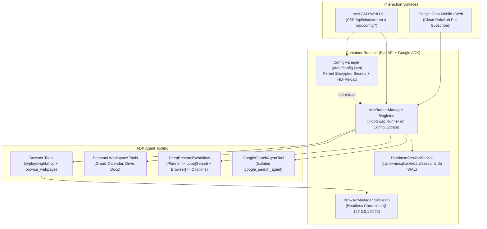

# Local ADK Personal Agent (`local-adk-agent`)

### Summary
`local-adk-agent` is a self-hosted Google Agent Development Kit (`google-adk`) and Google GenAI (`google-genai`) container designed to run on a personal Linux machine. It gives you a single persistent assistant—accessible from both a local Web UI and the Google Chat mobile app—without opening incoming ports on your home router or baking secrets into Git or Docker layers. The runtime combines live Google Search grounding, multi-hop Deep Research, personal Google Workspace OAuth 2.0 tools (Gmail, Calendar, Drive, Docs), Headless Chromium automation (`@playwright/mcp` + Python Playwright over a shared CDP port), and a Cloud Pub/Sub streaming pull bridge backed by a shared SQLite session store (`/data/sessions.db`).

---

## Architecture Overview



### Persistent Host Storage Contract (`~/.config/local-adk-agent/data:/data`)

All credentials, encryption keys, SQLite databases, OAuth tokens, and Chromium profiles live exclusively in `~/.config/local-adk-agent/data` on your Linux host (mounted to `/data` inside the container via `HOST_DATA_DIR`), **completely outside the repository and application directory**.
- Updating the container (`docker compose pull && docker compose up -d`), running `git pull` / `git clean -fdx`, or even deleting and re-cloning the repository folder will **never** overwrite or delete your stored credentials.
- Every credential file (`config.json`, `client_secret.json`, `workspace_token.json`, `gchat_service_account.json`) is written atomically (`fsync` + `os.replace`) with `0600` permissions and a rolling `.bak` backup (`config.json.bak`, `workspace_token.json.bak`, etc.), and partial UI updates or schema upgrades preserve all existing keys and offline OAuth `refresh_token` grants.

| Container Path | Purpose | Permissions |
| :--- | :--- | :--- |
| `/data/config.json` | Encrypted AI Studio `GEMINI_API_KEY`, default model, Gmail safety mode (`draft_only` vs `allow_send`), Google Chat Pub/Sub config, and owner email allowlist | `0600` |
| `/data/.secret.key` | Auto-generated 32-byte Fernet key used to encrypt secrets at rest in `/data/config.json` | `0600` |
| `/data/sessions.db` | Shared SQLite database (`WAL` mode) storing conversation sessions across Web UI and Google Chat | `0600` |
| `/data/client_secret.json` | Uploaded GCP OAuth 2.0 Client ID/Secret JSON for personal Workspace login | `0600` |
| `/data/workspace_token.json` | Authorized OAuth 2.0 offline refresh and access tokens for Gmail, Calendar, Drive, and Docs | `0600` |
| `/data/gchat_service_account.json` | GCP Service Account JSON key for the Cloud Pub/Sub pull subscriber and Google Chat REST API | `0600` |
| `/data/chrome-profile/` | Persistent Chromium `user-data-dir` preserving cookies and storage across container restarts | `0700` |
| `/data/screenshots/` | Timestamped PNG screenshots captured by Headless Chrome and served via `/api/screenshots/{filename}` | `0755` |

---

## 1. Publishing to GitHub Container Registry (`ghcr.io`)

1. Push this repository to GitHub:
   ```bash
   git init
   git add .
   git commit -m "Initial commit: Local ADK personal agent"
   git branch -M main
   git remote add origin git@github.com:garynation/local-adk-agent.git
   git push -u origin main
   ```
2. On every push to `main` (or `v*.*.*` tag), `.github/workflows/docker-publish.yml` runs two jobs:
   - **`secret-hygiene-check`**: Verifies that no credential files (`config.json`, `client_secret.json`, `workspace_token.json`, `gchat_service_account.json`, `.env`) are tracked and scans all commits for API keys, OAuth client secrets, or PEM private key blocks.
   - **`build-and-push`**: Builds the `linux/amd64` container image with Docker Buildx layer caching and publishes `ghcr.io/garynation/local-adk-agent:latest` using the repository's built-in `GITHUB_TOKEN`.

---

## 2. Deploying on Your Linux Box (`docker compose up -d`)

Run the following commands on your x86_64 (`linux/amd64`) Linux machine:

```bash
# 1. Create the external persistent credential directory (outside the app directory) with 0700 permissions
mkdir -p ~/.config/local-adk-agent/data
chmod 700 ~/.config/local-adk-agent/data

# 2. Create the deployment directory for docker-compose.yml
mkdir -p ~/local-adk-agent
cd ~/local-adk-agent

# 3. Download docker-compose.yml and .env.example (or clone the repository)
curl -fsSLO https://raw.githubusercontent.com/garynation/local-adk-agent/main/docker-compose.yml
curl -fsSL https://raw.githubusercontent.com/garynation/local-adk-agent/main/.env.example -o .env

# 4. If your GHCR package is private, log in with a read:packages token
echo "<GITHUB_PAT_WITH_READ_PACKAGES>" | docker login ghcr.io -u garynation --password-stdin

# 5. Pull and start the container
docker compose pull && docker compose up -d
```

Open `http://localhost:8080` in your browser and switch to **Settings** to configure your AI Studio `GEMINI_API_KEY`, authorize Google Workspace, and connect Google Chat.

---

## 3. GCP Workspace OAuth 2.0 & Google Chat Cloud Pub/Sub Setup

### Step 3.1: Enable Google Cloud APIs

In the Google Cloud project associated with your personal Google Workspace domain, enable the required APIs:

```bash
export GCP_PROJECT_ID="your-personal-workspace-project-id"

gcloud services enable \
  chat.googleapis.com \
  pubsub.googleapis.com \
  gmail.googleapis.com \
  calendar-json.googleapis.com \
  drive.googleapis.com \
  docs.googleapis.com \
  sheets.googleapis.com \
  --project="${GCP_PROJECT_ID}"
```

### Step 3.2: Create Personal Workspace OAuth 2.0 Client (`client_secret.json`)

1. In the GCP Console, navigate to **APIs & Services -> OAuth consent screen** and configure the screen as **Internal** (for your Workspace domain).
2. Navigate to **APIs & Services -> Credentials -> Create Credentials -> OAuth client ID**.
3. Select **Web application** and add `http://localhost:8080/api/auth/workspace/callback` under **Authorized redirect URIs**.
4. Download the JSON file, open the local Web UI **Settings** view, paste the JSON into **Personal Google Workspace (OAuth 2.0)**, and click **Authorize Workspace Account**.
5. By default, outbound Gmail operations stay in **`draft_only`** mode until you explicitly switch to **`allow_send`** in Settings.

### Step 3.3: Configure Zero-Port Google Chat via Cloud Pub/Sub

Instead of opening inbound router ports or chaining Apps Script to an expiring ngrok tunnel, Google Chat publishes events to a Cloud Pub/Sub topic and your home container pulls them outbound over gRPC/TLS:

```bash
# 1. Create the Cloud Pub/Sub topic and pull subscription
gcloud pubsub topics create adk-chat-inbound --project="${GCP_PROJECT_ID}"

gcloud pubsub subscriptions create adk-chat-inbound-sub \
  --topic=adk-chat-inbound \
  --ack-deadline=60 \
  --project="${GCP_PROJECT_ID}"

# 2. Grant the Google Chat system service account permission to publish to the topic
gcloud pubsub topics add-iam-policy-binding adk-chat-inbound \
  --member="serviceAccount:chat-api-push@system.gserviceaccount.com" \
  --role="roles/pubsub.publisher" \
  --project="${GCP_PROJECT_ID}"

# 3. Create the local bridge service account and grant subscriber permissions
gcloud iam service-accounts create adk-chat-bridge \
  --display-name="Local ADK Chat Bridge" \
  --project="${GCP_PROJECT_ID}"

gcloud pubsub subscriptions add-iam-policy-binding adk-chat-inbound-sub \
  --member="serviceAccount:adk-chat-bridge@${GCP_PROJECT_ID}.iam.gserviceaccount.com" \
  --role="roles/pubsub.subscriber" \
  --project="${GCP_PROJECT_ID}"

# 4. Download the service account key to upload in the Web UI Settings Console
gcloud iam service-accounts keys create gchat_service_account.json \
  --iam-account="adk-chat-bridge@${GCP_PROJECT_ID}.iam.gserviceaccount.com"
```

Finally, in the GCP Console under **APIs & Services -> Google Chat API -> Configuration**:
- Set **App name** to `ADK Personal Agent`.
- Enable **Interactive features** -> **Receive 1:1 messages** and **Join spaces and group conversations**.
- Under **Connection settings**, select **Cloud Pub/Sub** and enter `projects/<GCP_PROJECT_ID>/topics/adk-chat-inbound`.
- Under **Visibility**, restrict access to your personal Workspace email address (`owner@yourdomain.com`), then upload `gchat_service_account.json` and add your email to the allowlist in the Web UI **Settings** tab.

---

## 4. Running Tests Locally

```bash
DATA_DIR=/tmp/adk_test_data PYTHONPATH=. pytest tests/
```
